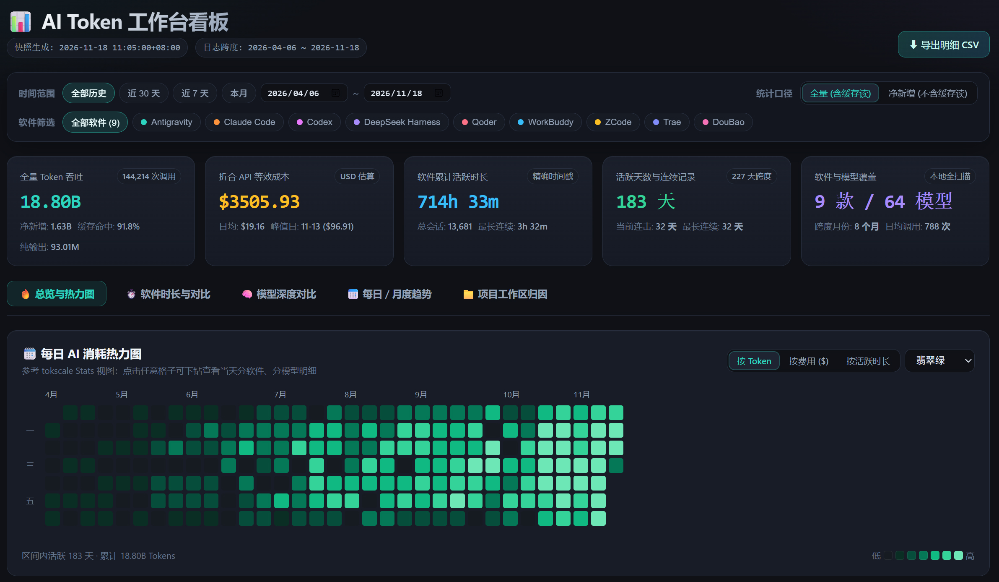
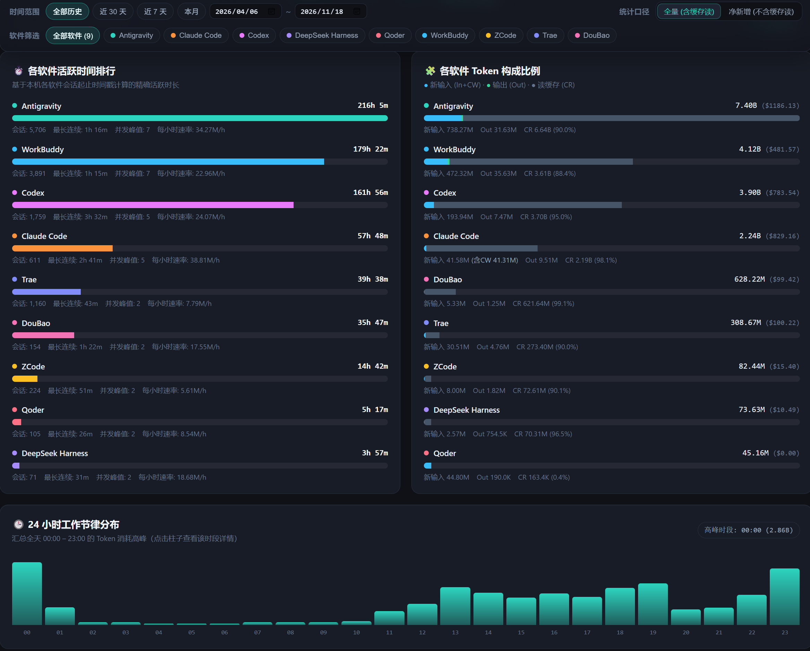
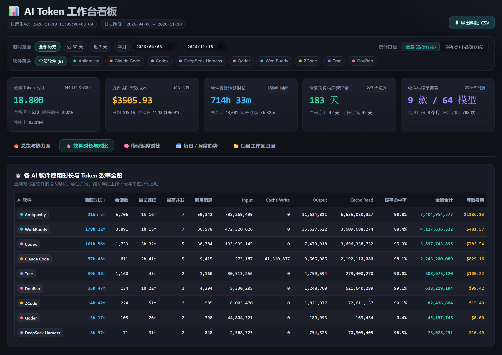
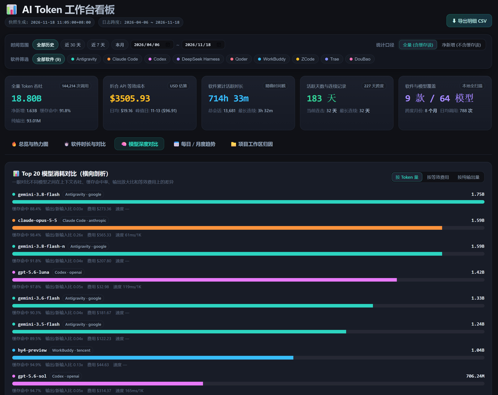
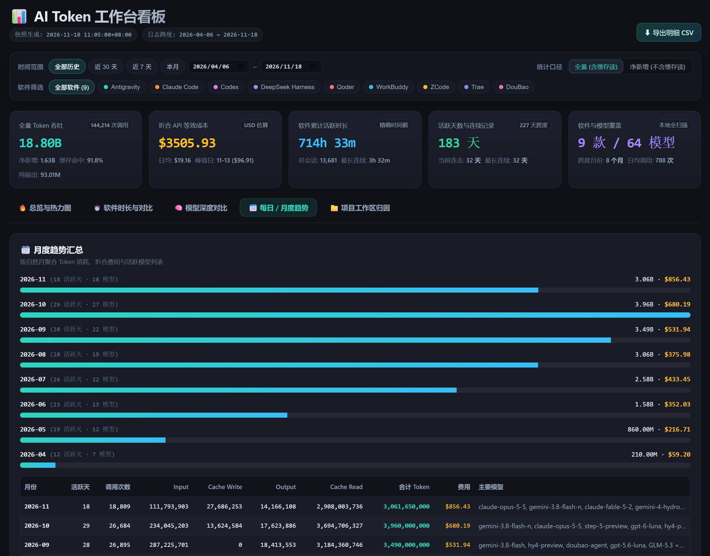
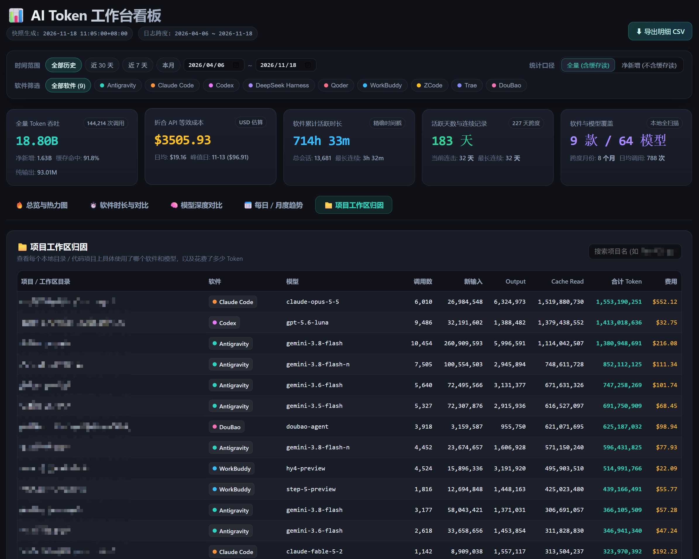

# 📊 AI Token 工作台看板（本地离线单文件可视化分析工具）

[](https://github.com/JackHua6/Ai-Token-Dashboard)
[](https://www.python.org/)
[-a78bfa.svg)](https://nodejs.org/)
[](LICENSE)

> **一站式汇总你电脑上所有 AI 编程工具与办公 Agent 的真实消耗与工作时长！**  
> 本工具全自动扫描本机各类 AI 客户端日志，把 **Token 吞吐、折合 API 费用、活跃工作时长、24 小时节律、分模型深度指标、代码项目归因** 全部离线打包进一个 **零依赖单文件 HTML 网页 (`token_dashboard.html`)**，双击即可在浏览器交互查看。  
> **🔒 100% 本地运行**：所有扫描与聚合均在你自己电脑上完成，**绝不向任何外部服务器上传你的对话记录或代码目录**。

---

## 🖼️ 真实案例截图（多客户端聚合效果）

以下为跨度 8 个月、涵盖 9 款 AI 工具与 64 个模型的实测汇总效果：

### 1. 全局总览 & 5 大核心 KPI + 6 级消费热力图

- 顶部一眼掌握：**全量/净新增 Token 吞吐、折合 API 等效成本（含日均与峰值日）、累计精确活跃时长与总会话数、活跃天数与连击纪录、软件/模型覆盖数**。
- 下方为 **GitHub 风格 6 级深度热力图**，支持在 **Token / 费用 ($) / 活跃时长** 与 **4 套渐变配色（翡翠绿 / 科技青 / 烈焰橙 / 雅紫罗兰）** 间秒切，点击任意一天可直接下钻查看当天的分软件、分模型流水明细。

### 2. 各软件活跃时长排行 + Token 构成比例 + 24 小时工作节律

- **左图（活跃时长排行）**：基于本机实际会话起止时间戳统计投入时长、会话数、最长连续工作时长、并发峰值与每小时吞吐速率（M/h）。
- **右图（Token 构成比例）**：用分段堆叠条形图直观拆解每款工具的 **新输入（`Input + Cache Write` 蓝条）/ 纯输出（`Output` 绿条）/ 缓存读取（`Cache Read` 灰条）** 及对应等效成本。
- **底部（24 小时工作节律）**：分软件独立聚合全天 `00:00 – 23:00` 高峰习惯（单独筛选某款软件时自动剥离同期其他软件的流量）。

### 3. 各 AI 软件使用时长与效率明细表

- 13 列表格横向对比所有 AI 客户端，支持点击任意列头升降序排列。

### 4. 模型深度对比（Top 20 横向剖析 + 全模型总表）

- 横向对比热门 Top 20 模型在 **总 Token / 等效费用 / 纯输出量** 三维指标下的表现，自动计算 **缓存命中率** 与 **输出/新输入比**，并内置厂商计费口径科普说明（解释 Anthropic 显式 `Cache Write` 与 OpenAI/Google 隐式建缓存差异）。

### 5. 月度 / 每日趋势流水汇总

- 按自然月对比活跃天数、调用次数、`Input / CW / Output / CR`、月度费用与当月 Top 5 主力模型；下方附每日倒序流水表，点击任意日期行即可跳转热力图下钻。

### 6. 项目 / 代码工作区归因（支持一键隐私脱敏）

- 精确归因到本机每一个代码目录 / 任务工作区究竟用了哪款软件、哪个模型、花了多少钱；右上角内置 **「🙈 隐私脱敏」** 按钮，点击即可一键将所有真实文件夹路径匿名化为 `工作区 #1`、`工作区 #2`（如上图打码效果所示），方便安心截图分享！

---

## 🎯 核心功能与可用能力全清单

### 一、支持扫描的 AI 工具（60+ 款，自动识别本机已安装软件）
1. **基于 `tokscale` 引擎全自动扫描**：
   - **IDE / 编辑器插件**：Google Antigravity（App / Extension / CLI）、Cursor、Windsurf、Trae / Trae CN、ZCode、Qoder、GitHub Copilot、Cline、Roo Code、Kilo Code、Zed AI、CodeBuddy、WorkBuddy 等。
   - **终端 / Agent CLI**：Claude Code、OpenAI Codex（App & CLI）、Gemini CLI、OpenCode、Kimi CLI、Qwen Code、DeepSeek Harness (DSH)、Warp、Amp、Droid、OpenClaw 等 60+ 客户端。
2. **Windows 原生内置「豆包工作 (DouBao Work)」本地轨迹解析**：
   - 自动扫描 `%LOCALAPPDATA%\DoubaoWork\User Data` 下的真实 Agent 对话轨迹，优先调用其自带 `tiktoken (cl100k_base)` 精确分词，若无沙箱则自动使用校准分词器兜底，并还原每次任务起止活跃时长。
3. **可选导入历史导出归档 (`trae-archive.json`)**：
   - 支持在同目录放置自定义导出的 `trae-archive.json` 归档文件（格式参见 `refresh_dashboard.py`），自动与其他客户端无损合并展示。

### 二、前端看板交互功能（全部离线可用，零后端依赖）
| 模块 | 你可以直接使用的功能 |
| :--- | :--- |
| **全局时间范围筛选** | 支持 **全部历史 / 近 30 天 / 近 7 天 / 本月** 一键切换，以及 **任意自定义开始~结束日期**（自动按日权重分摊精确计算所选区间活跃时长，选反日期自动纠偏）。 |
| **多软件组合筛选** | 点击顶部任意软件胶囊支持单选/多选对比；筛选后出现 **「↺ 重置筛选」** 一键还原。 |
| **统计口径双模切换** | **「全量 (含缓存读)」** vs **「净新增 (不含缓存读)」**：剔除重复缓存读取后横向公平对比 Claude 与 GPT/Gemini/国产模型的新增上下文消耗。 |
| **热力图交互与主题** | 支持切换 **按 Token / 按费用 / 按活跃时长**，支持 **4 套色板（翡翠绿 / 科技青 / 烈焰橙 / 雅紫罗兰）** 与 **6 级色彩深度**；悬停查看当日摘要，点击方格展开当日软件/模型明细。 |
| **模型与项目检索** | 模型表支持关键词搜索、按厂商 (`Provider`) 过滤、任意字段点击排序；项目表支持目录关键词模糊搜索。 |
| **🙈 一键隐私脱敏** | 点击右上角 **「🙈 隐私脱敏」** 即刻把本地文件夹真实路径替换为匿名编号，再次点击还原，截图发群不泄密。 |
| **⬇ 导出明细 CSV** | 按当前筛选条件（时间范围 + 软件多选）一键导出 **`UTF-8-SIG` 编码 CSV**，Windows Excel 直接双击打开零乱码。 |

---

## 🚀 快速开始（30 秒跑通你自己的数据）

### 1. 环境准备（仅两项基础依赖）
- **Python 3.9+**（Windows 安装包请务必勾选 *Add Python to PATH*）
- **Node.js 18+**（建议先在终端执行一次 `npm install -g tokscale` 预装扫描引擎；如果不预装，首次运行时脚本也会自动通过 `npx` 按需拉取）

### 2. 下载并运行
```bash
git clone https://github.com/JackHua6/Ai-Token-Dashboard.git
cd Ai-Token-Dashboard
```

- **Windows 用户**：直接双击文件夹里的 **`刷新并打开看板.bat`**，等待约 10~30 秒自动扫描完毕并弹窗打开浏览器。
- **macOS / Linux 用户**：
  ```bash
  chmod +x refresh.sh
  ./refresh.sh
  ```
- **仅在后台刷新（不弹窗打开浏览器，适合定时任务）**：
  ```bash
  python3 refresh_dashboard.py --no-open
  ```

> **💡 给其他 AI 用户的小技巧**：  
> 每个人的电脑环境、Python/Node 安装位置和 AI 软件缓存目录可能略有不同。如果你把本仓库下载后运行遇到缺依赖、报错或某些客户端没扫到，**直接打开你的 AI 助手（Antigravity / Claude Code / Codex / Cursor 等）把下面这句话发给它，它就会按你的电脑环境现场帮你修好：**
>
> `请帮我检查并运行当前目录下的 refresh_dashboard.py，如果缺环境依赖、tokscale 未安装或某个 AI 客户端日志在我自定义的盘符目录里，请帮我修复并适配后生成我的 token_dashboard.html。`

---

## 🛠️ 常见问题排查

1. **直接双击 `token_dashboard.html` 显示“尚未扫描本地 AI 使用记录”？**  
   这是正常的。为保护作者与开源仓库洁净，仓库里的 `token_dashboard.html` 默认是**空模板**（不包含任何人的历史数据），请先双击运行一次 `刷新并打开看板.bat`（或 `refresh.sh`）把你本机的数据写入 HTML 中即可。
2. **提示 `未检测到 tokscale 或 Node.js`？**  
   请确认终端可执行 `node -v` 和 `npm -v`，建议运行 `npm install -g tokscale` 后重试；若安装在非标准位置，可设置环境变量 `TOKSCALE_BIN=/你的路径/tokscale`。
3. **黑框一闪而过或没反应？**  
   新版 `.bat` 报错时会自动 `pause` 停留在终端窗口展示中文报错原因；也可以在目录空白处右键「在终端中打开」，手动执行 `python refresh_dashboard.py` 查看完整日志。
4. **如何分享给别人看我自己的看板成果？**  
   扫描完成后，`token_dashboard.html` 就是一个 **完整自包含的单文件网页**（所有数据已内嵌，不依赖 `.py` 或本地服务器），先点击「🙈 隐私脱敏」截长图，或直接把这个 HTML 文件发给别人用浏览器打开即可。
